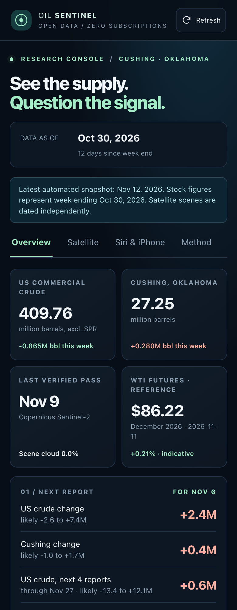
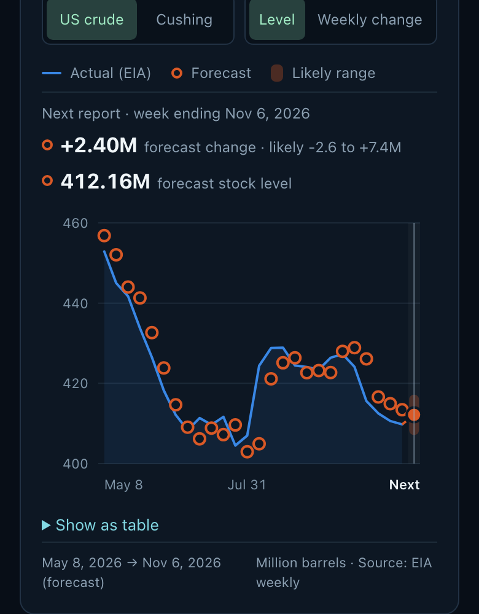

# Oil Sentinel

Live app: https://anujb6.github.io/oil-sentinel/

  
  

## What it computes

Every week the U.S. Energy Information Administration (EIA) publishes how much crude oil is in storage. The app downloads the official figures and works out three things.

### 1. This week's change

The stock level this week minus last week, in million barrels, for:

- US commercial crude (excluding the government's emergency reserve)
- Cushing, Oklahoma (where US crude futures are delivered)
- Gasoline and distillates (diesel and heating oil)

**Inventory pressure:** if US crude and Cushing both fell, stocks are drawing (supply is tightening). If both rose, stocks are building. If they moved in opposite directions, the picture is mixed.

### 2. Next week's forecast

**US crude: "what usually happens this week of the year."**
Take the same week, plus the week either side, in each of the last 10 years, and average the change. Refinery maintenance, driving season and winter heating repeat every year.
*Example:* around early November the last 10 years averaged a build of about 2.4 million barrels, so the forecast is +2.4M.

**Cushing: "it keeps going the way it has been going."**
Pipelines fill and drain Cushing over several weeks, so its moves come in slow waves. The forecast is about 60% of its average weekly change over the last 4 weeks, plus a small seasonal nudge.
*Example:* if Cushing rose about 0.6M a week recently, the forecast is about +0.4M.
The exact weights come from a ridge regression that is re-learned from history every year (`scripts/forecast.py`).

**US crude, next 4 reports:** the same seasonal average, added up over the next four weeks.

### Forecast against the chart

The chart puts every past forecast (orange rings) next to what EIA actually reported (blue), for the last 26 weeks. The next report's forecast and its likely range sit in the shaded column on the right. Switch between **Level** (the stock level) and **Weekly change** (the week-to-week move). Tap or drag across the chart to read any week. **Show as table** lists the same numbers.

### 3. The "likely" range

Check how far off the forecast was each week over the last 3 years. Drop the biggest 10% of misses on each side, and use the rest as the range around the forecast. About 8 weeks in 10 should land inside it.

## How we know the forecast works

Every week from 2010 to today was replayed using only the data that existed at the time. The model was refit each year and scored only on weeks it had never seen.

| | Typical miss | A "no change" guess misses | Right direction (moves over 1M) |
|---|---|---|---|
| US crude | ±3.5M barrels | ±3.9M | 69% |
| Cushing | ±0.88M | ±1.00M | 78% |

The ranges held in 76% of weeks.

For US crude, fancier models using production, imports, exports and refinery runs (ridge regression and gradient boosting) were no better than the simple seasonal average, so the simple one is used.

The app recomputes these numbers on every refresh and shows them under the forecast.

## What it can't do

It can't see tankers, refinery outages or storms. A typical US miss is almost as big as a typical week's move, so read the forecast as "normal for this time of year", a baseline to compare the real EIA number against. It is not a trade signal.

## Data and refresh

- **Stocks:** official EIA weekly files, free and with no API key.
- **Refresh:** a GitHub Actions job runs daily, and hourly on Wednesday and Thursday evenings (UTC), so each new EIA report appears within about an hour.
